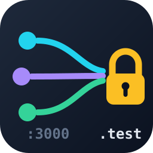
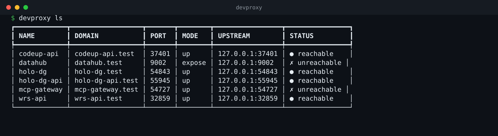

# devproxy

<p align="center">
  
</p>

<p align="center">
  <a href="https://github.com/wenbinye/devproxy/actions/workflows/ci.yml"></a>
  <a href="https://pypi.org/project/devproxy/"></a>
  <a href="LICENSE"></a>
  
  
</p>

本地开发环境一键部署与域名网关。把本地跑起来的服务用 `https://<name>.test` 暴露出去，
开发者只记域名，不记端口。

> **注意**：本项目的默认语言是英文 —— CLI 输出、错误提示与代码注释均为英文；
> 本页与 `docs/zh-CN/` 是完整的中文镜像文档。

<p align="center">
  
</p>

## 本地服务，用真正的 HTTPS 域名访问

`devproxy` 把本地跑起来的服务放到 `https://<name>.test` 后面 —— 开发者只记域名，
不记端口。

```bash
devproxy up api -- npm run dev
# ✅ https://api.test
```

| 得到什么 | 为什么重要 |
|---|---|
| **整套环境一条命令** | `devproxy setup` 装好 Caddy + dnsmasq、把 `*.test` 指向本机、把 CA 装进系统信任库、开好自启 —— 不用自己写配置文件 |
| **一个应用一个域名，不是端口** | `https://api.test` 而不是 `https://localhost:3000` —— 能直接发给同事，浏览器也不再报证书警告 |
| **路由表是文件** | `routes.json` —— Caddy 重启后路由还在，不需要常驻守护进程 |
| **能和全组共享** | 提交一份 `devproxy.toml`，所有人跑同一套域名 |

---

## ⚠️ 这个工具会修改你的系统

`devproxy setup` 不是「装个 Python 包就完事」。它会写系统目录、装服务单元、
改 DNS 解析路径、把自签 CA 装进系统信任库。**请先读完这一节再运行。**

它会改动的东西：

| 改动 | 位置（Linux） | 位置（macOS） |
|---|---|---|
| Caddy 二进制 | `~/.local/bin/caddy`（下载，校验 sha256） | 同左 |
| Caddy 主配置 | `~/.config/devproxy/Caddyfile` | 同左 |
| 你的个人站点 | `~/.config/devproxy/sites.caddy`（只 import，不改内容） | 同左 |
| Caddy 服务单元 | `~/.config/systemd/user/caddy.service`（user scope） | `/Library/LaunchDaemons/com.devproxy.caddy.plist`（**root** LaunchDaemon） |
| dnsmasq 服务单元 | `~/.config/systemd/user/dnsmasq.service`（user scope） | `~/Library/LaunchAgents/com.devproxy.dnsmasq.plist` |
| dnsmasq 配置 | 增量合并 `~/.config/dnsmasq/dnsmasq.conf` | 同左 |
| DNS 路由 | `/etc/systemd/resolved.conf.d/devproxy.conf`（或 `/etc/dnsmasq.d/devproxy.conf`） | `/etc/resolver/test` |
| CA 根证书 | `/usr/local/share/ca-certificates/devproxy-local.crt` + NSS 库 `~/.pki/nssdb` | 系统钥匙串 `/Library/Keychains/System.keychain` |
| 开机自启 | `loginctl enable-linger <用户>` | launchd 的 `RunAtLoad` |

**DNS 路由的改动是整机范围的（Linux `resolved` 后端）** —— 这一点必须单独说清楚：

- 写进 drop-in 的 `DNS=127.0.0.1:5353` 落在 resolved 的**全局段**，它决定的是
  **这台机器全部域名**的解析先去问用户级的 dnsmasq，**不只是 `*.test`**；
- 同一份 drop-in 里还有一行 `FallbackDNS=1.1.1.1 8.8.8.8`，它是**整机兜底**：
  dnsmasq 起不来的时候，全机解析退化为这两个公共解析器；
- `Domains=~.<后缀>` 才是把 `<后缀>` 交给 dnsmasq 的那一条 —— 但在
  `DNS=` 已经把全机解析指向 dnsmasq 的前提下，它只决定 dnsmasq 内部怎么分流。

`devproxy setup` 在打印变更清单时会把这段整机作用域**单独打一遍**（表格里放不下，
也放不下重点），你点确认之前就会看到。macOS 的每域解析器文件与 Linux `system`
后端的 dnsmasq 片段**只影响本后缀**，不涉及整机。

**需要 sudo 的步骤**：

- Linux
  - `sudo setcap cap_net_bind_service=+ep ~/.local/bin/caddy`（让 caddy 能绑 80/443）
  - `sudo` 写 `/etc/systemd/resolved.conf.d/devproxy.conf`，并 `sudo systemctl restart systemd-resolved`
  - `sudo loginctl enable-linger <用户>`（开机自启，未登录也跑）
  - `sudo` 把 CA 装进系统信任库并执行 `update-ca-certificates`
- macOS
  - `sudo` 写 `/Library/LaunchDaemons/com.devproxy.caddy.plist`（macOS 没有 `setcap`，
    绑 80/443 只能靠 root 跑的 LaunchDaemon）
  - `sudo` 写 `/etc/resolver/test`
  - `sudo security add-trusted-cert -d -r trustRoot -k /Library/Keychains/System.keychain <ca>`

**不需要 sudo 的步骤**：下载 caddy、写 `~/.config/devproxy/` 与 `~/.local/state/devproxy/`、
合并 dnsmasq 配置、安装 systemd user 单元 / LaunchAgent、装 NSS 库（需要 `certutil`）。

非交互环境（CI、脚本）里跑 `setup` / `trust`，如果需要提权，必须显式加 `--yes`，
否则工具会以退出码 4 拒绝执行（不会默默跳过，也不会默默提权）。

**想撤回？** 见下面的[「卸载」](docs/zh-CN/migration-and-uninstall.md#卸载)：`devproxy uninstall --dry-run` 可以先看它会做什么。

---

## 安装

**macOS / Linux，一条命令：**

```bash
curl -fsSL https://raw.githubusercontent.com/wenbinye/devproxy/main/scripts/install.sh | sh
```

脚本会取最新 release、校验 sha256、把 CLI 装进 `~/.local/bin` —— **全程不需要 sudo**
（需要提权时由 `devproxy setup` 自己在需要的那一步提）。

**发布到 PyPI 之后**，常规装法也可以用：

```bash
uv tool install devproxy     # 或者：pipx install devproxy
```

**从源码仓库装**（任意版本，不需要 release）：

```bash
uv tool install 'git+https://github.com/wenbinye/devproxy.git'
```

想钉住分支 / 标签 / 提交：

```bash
uv tool install 'git+https://github.com/wenbinye/devproxy.git@main'
uv tool install 'git+https://github.com/wenbinye/devproxy.git@<tag 或 commit>'
```

不写 `@…` 时取仓库的默认分支（当前是 `main`）。升级到远端最新：

```bash
uv tool upgrade devproxy
```

没装 `uv` 的话：macOS `brew install uv`，Linux 用官方安装脚本。

不想用 uv，也可以用 pipx（同样的 git 地址）：

```bash
pipx install 'git+https://github.com/wenbinye/devproxy.git'
```

**本地开发**用可编辑安装 —— 改源码即生效，不必每次重装：

```bash
git clone https://github.com/wenbinye/devproxy.git
cd devproxy
uv tool install -e .
```

发布到 PyPI 之后，`uv tool install devproxy` 才可用 —— 在那之前这条命令会失败
（PyPI 上没有这个包，且这个名字将来可能与别的包冲突）。

依赖：Python ≥ 3.11（uv 会自动挑一个合适的解释器），运行时依赖只有 `typer` 与 `rich`。

安装后 `devproxy --help` 应能列出全部子命令。命令落在 `~/.local/bin/devproxy`；
如果 `command -v devproxy` 找不到，跑一次 `uv tool update-shell`，或把 `~/.local/bin` 加进 `PATH`。

---

## 快速开始

```bash
devproxy setup     # 部署 Caddy + dnsmasq + DNS 路由 + 服务自启（幂等，可重复执行）
devproxy doctor    # 体检（静态检查，不做 DNS 解析）：缺什么给什么修复命令
```

`setup` 之后：

```bash
# 启动一个服务并注册 https://codeup.test
devproxy up codeup -- sh -c 'npx vite --port $PORT --host 127.0.0.1'

# 给已经在跑的服务开域名（不启动它）
devproxy expose console --port 3000

devproxy ls                 # 路由清单（含可达性）
devproxy down codeup        # 注销路由（子进程也一并收掉）
devproxy logs caddy         # 跟随日志（Ctrl-C 退出，不会自己结束）

# 项目里有一份 devproxy.toml（提交进仓库、全组共享）时：
devproxy up               # 按声明同步路由
```

### CA 根证书是在第一条路由注册之后才存在的

Caddy 的内部 CA **在第一次加载 `tls internal` 站点时**才生成 —— 也就是**第一条路由被注册时**
（`devproxy up` 或 `devproxy expose` 都算）。所以在一台干净的机器上：

1. `devproxy setup` 成功，但此时系统里**还没有 CA 根证书**（`setup` 结束时会把这条提示打出来）；
2. 第一次注册路由（`devproxy up <name> -- ...` 或 `devproxy expose <name> --port N`）之后，
   Caddy 才生成 CA；
3. **这时还需要跑一次 `devproxy trust`**，curl / Chrome 才会信任它。

`devproxy doctor` 在 CA 尚未生成时显示「尚无 CA 根证书（将在首条路由注册时由 Caddy 生成）」，
这是正常状态，不是故障。

---

## 命令

| 命令 | 说明 |
|---|---|
| `devproxy setup` | 部署本地开发环境（幂等，可重复执行） |
| `devproxy setup --rollback <备份目录>` | 按备份目录回滚（见「迁移与回滚」） |
| `devproxy doctor` | 体检所有前置条件（静态检查：文件在位、服务在跑、证书已装、单元指向本工具），缺什么给什么修复命令 |
| `devproxy up <name> [--port N] [--ready-timeout S] -- CMD...` | 分配端口、启动命令、注册 `https://<name>.test` |
| `devproxy expose <name> --port N` | 给已在运行的服务开域名，注册后立即返回，路由常驻（上游暂时无响应时只告警，路由照样注册） |
| `devproxy down <name>` | 注销路由；若该路由的子进程还在，一并收掉 |
| `devproxy ls` / `devproxy ps` | 列出所有已注册路由（含可达性），按应用名升序 |
| `devproxy logs [caddy\|dnsmasq\|<路由名>]` | 跟随日志：服务本身（默认 `caddy`）或 sync 起的应用 |
| `devproxy logs <路由名> --edit` | 用 `$EDITOR` 打开该路由的日志文件（未设时依次找 `vim` / `vi` / `nano`；`--list` 看有哪些、连完整路径） |
| `devproxy trust` | 单独安装 CA 根证书（系统信任库 + NSS 库 / 系统钥匙串） |
| `devproxy config` | 显示当前生效配置与渲染出的路由片段 |
| `devproxy selftest` | 隔离 Caddy 实例端到端自检 |
| `devproxy uninstall` | 卸载：停服务、移除单元、DNS 路由与（可选）CA。默认保守保留你的配置、个人站点、Caddy 存储与备份 |
| `devproxy up` | 在项目里：按 `devproxy.toml` 应用**全部**声明（compose 的 `up -d`） |
| `devproxy down` | 在项目里：停掉本项目声明的**所有**应用；带路由名则只停那一条 |
| `devproxy run` | **前台**托管 Caddy（不装服务、不留状态，Ctrl-C 退出）。没有 systemd 的环境（容器 / WSL）用它替代服务 |
| `devproxy init` | 在项目里生成 `devproxy.toml`（路由名取目录名，启动命令按项目类型猜或用 `--command` / `--from` 指定） |
| `devproxy --install-completion` | 装 shell 补全：命令、选项，以及 `logs` / `down` 里的**路由名**（bash / zsh / fish / powershell） |

常用选项与各命令的全部选项：见 [docs/zh-CN/commands.md](docs/zh-CN/commands.md)。


---

## 文档

英文文档：[README.md](README.md) 与 [docs/](docs/)。本页及 `docs/zh-CN/` 是中文镜像。

详细说明拆在 [docs/](docs/) 下，按需查阅：

| 文档 | 内容 |
|---|---|
| [docs/zh-CN/commands.md](docs/zh-CN/commands.md) | 全部命令、选项、退出码 |
| [docs/zh-CN/apps.md](docs/zh-CN/apps.md) | 应用接入：`expose`、`$PORT` 的两种写法、注意事项 |
| [docs/zh-CN/dns-and-certs.md](docs/zh-CN/dns-and-certs.md) | DNS 路由、证书信任（含 Firefox）、`doctor` 与 `setup` 分工 |
| [docs/zh-CN/configuration.md](docs/zh-CN/configuration.md) | `config.toml` 全部配置项、域名后缀白名单、storage 留档 |
| [docs/zh-CN/project-config.md](docs/zh-CN/project-config.md) | `devproxy.toml`：`up` / `down` 的声明式工作流 |
| [docs/zh-CN/platforms.md](docs/zh-CN/platforms.md) | 目录与文件、平台差异、没有 systemd 时用 `devproxy run` |
| [docs/zh-CN/migration-and-uninstall.md](docs/zh-CN/migration-and-uninstall.md) | 迁移与回滚、卸载 |
| [docs/zh-CN/troubleshooting.md](docs/zh-CN/troubleshooting.md) | 故障排查 |
| [docs/zh-CN/development.md](docs/zh-CN/development.md) | 开发与 CI、代码结构 |

按场景找文档：[docs/zh-CN/README.md](docs/zh-CN/README.md)。
真机验证清单：[docs/verification-checklist.md](docs/zh-CN/verification-checklist.md)。

---

## 参与

| 文件 | 什么时候看 |
|---|---|
| [CONTRIBUTING.md](CONTRIBUTING.md) | 提 PR 之前：开发环境、检查清单、代码风格 |
| [CODE_OF_CONDUCT.md](CODE_OF_CONDUCT.md) | 参与社区的行为准则 |
| [SECURITY.md](SECURITY.md) | 报安全问题（**不要**开公开 issue）；以及这个工具会改你系统的边界 |
| [CHANGELOG.md](CHANGELOG.md) | 每个版本的用户可见变化 |

## 许可

[MIT](LICENSE) © 2026 Ye Wenbin
